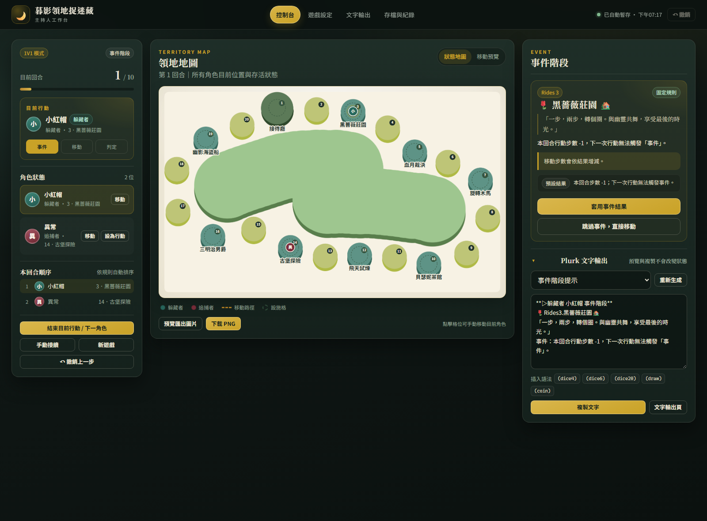
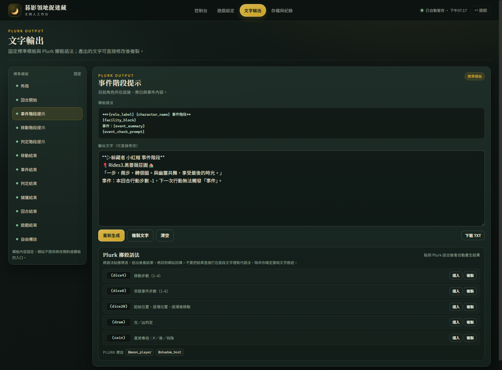

# 《暮影領地捉迷藏》主持人工作台｜使用說明

本文件對應 `README.md` 的規格與 `PLURK遊戲規則.txt`。規則已於 2026-11-13 定案並寫入程式，網站不提供規則編輯、規則庫或待確認頁；使用者只會看到固定的遊戲規則與操作介面。



---

## 一、快速開始

### 直接開啟

在檔案總管雙擊 `index.html` 即可使用。所有資料都內嵌在 JS 中，地圖底圖也已轉為 data URI，不需要伺服器或網路連線。

> 部分瀏覽器會封鎖 `file://` 的 LocalStorage；此時網站會自動改用記憶體暫存，並在右下角提示。重要進度請用「存檔與紀錄 → 匯出遊戲 JSON」備份。

### 使用本機伺服器（建議）

```bash
cd VibeCoding2
python -m http.server 8000
```

開啟 <http://127.0.0.1:8000/>。這個方式可以完整使用 LocalStorage 自動存檔。

### 部署到 GitHub Pages

`index.html` 位於專案根目錄，直接將整個資料夾推到 GitHub Pages 即可；不需要建置步驟。

---

## 二、五分鐘上手

1. 到「遊戲設定」建立新遊戲：
   - 選 1V1 或多人模式。
   - 每位玩家填入 **PLURK ID**（不用打 `@`）與**角色名稱**。
   - 起始位置由參與者擲 `(dice20)` 決定，主持人把結果選進欄位。
   - 多人模式可加入 1–4 位躲藏者。
2. 回到「控制台」，依右側面板的階段操作：
   - **事件** → 複製面板上的擲骰語法到 Plurk，擲完把結果選進網站，按「套用事件結果」。
   - **移動** → 選 `(dice4)` 點數與方向，按「預覽移動」。
   - **途經** → 若經過設施，面板會停下來要求輸入判定；套用後會自動繼續走完剩餘步數。
   - **判定** → 若與對方同格或互相途經，面板會列出遭遇判定；輸入 `(draw)`／`(coin)` 結果後確認。
   - **文字** → 下方「Plurk 文字輸出」可選模板、修改、插入語法、複製。
3. 需要圖片時，按「預覽匯出圖片」或「下載 PNG」。
4. 換角色：按左側「結束目前行動 / 下一角色」；系統會依模式自動排序下一位。
5. 每按一次確認，系統都會自動存檔，並保留可撤銷的快照。

---

## 三、頁面功能

| 頁面 | 內容 |
|---|---|
| 控制台 | 左：回合、角色、順序；中：20 格地圖；右：事件／移動／判定操作與 Plurk 文字 |
| 遊戲設定 | 建立新遊戲、手動接續、逐項修正回合／階段／位置、貼上 JSON 接續 |
| 文字輸出 | 固定標準模板、產出文字編輯、複製、下載 TXT、Plurk 擲骰語法與 @ 標註 |
| 存檔與紀錄 | 自動存檔狀態、具名存檔、JSON 匯出／匯入、操作紀錄、撤銷、清除遊戲 |

網站沒有規則庫、沒有待確認清單、也沒有模板編輯器。

---

## 四、已定案的規則（網站固定實作）

1. **終點設施**：移動終點是設施格時，不觸發途經；也不在移動階段觸發事件。事件在**下一次行動的事件階段**處理。
2. **骰子語法**：`(draw)` 產生吉／凶，`(coin)` 產生 P／骨／特殊，`(dice4)`、`(dice6)`、`(dice20)` 由 Plurk 產生數值。網站只負責提供語法與回填結果。
3. **黑薔薇莊園**：事件步數 -1；該角色**下一次行動**無法觸發事件。
4. **古堡探險**：追捕者途經使最大回合數歸零或變負時，**這回合的追捕者行動結束後**遊戲結束（由躲藏者獲勝）。
5. **接待廳**：只有躲藏者能觸發；需有已退場的躲藏者。凶的結果是「指定者返場，觸發事件的躲藏者本人退場」。返場者擲 `(dice20)` 決定位置，下回合開始行動；每人最多返場 2 次。
6. **飛天試煉**：傳送後立即結束行動，不在當回合觸發新位置的事件或途經。
7. **步數下限**：任何效果把步數扣到 0 以下時視為 0，不能移動。
8. **抵達順序**：每次移動完成記錄抵達序號；同格比較序號，小者先行動。
9. **途經限制**：同一次行動只觸發第一個途經設施；額外移動、反向移動都不重置此限制。
10. **勝負**：1V1 捕獲即追捕者勝、回合上限即躲藏者勝；多人全員被捕獲為異常勝、回合上限為躲藏者勝。
11. **步數計算**：`(dice4)` 的點數＝走幾格，起點不算。從 1 走 3 格會停在 4。
12. **設施適用**：除接待廳多人追加事件外，其餘設施的事件與途經對躲藏者、追捕者都適用。
13. **同格加骰**：回合開始同格有複數躲藏者時，輸入等量 `(draw)`；全部相同時，**每位**該格躲藏者在自己移動時可以多骰一次 `(dice4)`（可選擇不使用）。
14. **Plurk 格式**：保留擲骰語法、表符、`@` 標註；網站提供標準規則模板與語法支援，主持人可在輸出文字中自行加演出。
15. **名稱**：玩家欄位是 PLURK ID（輸出時自動加 `@`），角色名稱是敘事用名稱；文字預設使用角色名稱。
16. **血月裁決**：原移動結束後可再走一段 `(dice4)`，可選新方向，並重新判定途經。

### 已實作的特殊流程

- 1V1 與多人模式的回合順序、事件／移動／途經／判定。
- 多人同格 `(draw)` 加骰、異常 `(coin)`、特殊結果移動到最近躲藏者、同格捕獲最後抵達者。
- 有躲藏者被捕獲時，其餘躲藏者可擲 `(dice20)` 選擇性移動（不觸發途經）。
- 接待廳返場與本人退場、返場次數上限。
- 古堡降低最大回合數至 0／負數後的結束判定。
- 血月裁決的額外移動（可選方向、重新判定途經）。
- 手動移動、手動狀態修正、完整狀態撤銷、LocalStorage 自動存檔、JSON 備份。

---

## 五、Plurk 文字與語法

### 5.1 PLURK ID 與角色名稱

- **PLURK ID**：輸入帳號即可，不用打 `@`；網站輸出時會自動變成 `@id`。
- **角色名稱**：敘事中使用的名字，例如「小紅帽」。
- 地圖標記、行動順序、階段提示都使用角色名稱；PLURK ID 只在「佈局」模板以 `@` 標註，方便一次 tag 所有玩家。

### 5.2 擲骰語法

| 語法 | 用途 |
|---|---|
| `(dice4)` | 移動步數、部分設施的額外移動 |
| `(dice6)` | 貝瑟妮茶館事件步數 |
| `(dice20)` | 起始位置、返場位置、退場後移動 |
| `(draw)` | 吉／凶判定 |
| `(coin)` | 異常專用：P／骨／特殊 |

使用方式：把語法貼到 Plurk 送出，看 Plurk 產生的結果，再回到網站選入結果。
「文字輸出」頁提供每個語法的插入與複製按鈕；控制台的文字面板也有插入語法快捷鍵。

### 5.3 標準模板

「文字輸出」頁左側是固定模板：



- 佈局
- 回合開始
- 事件階段提示
- 移動階段提示
- 判定階段提示
- 移動結果
- 事件結果
- 判定結果
- 捕獲結果
- 回合結束
- 遊戲結束
- 自由備註

控制台與文字輸出頁會依目前階段自動選對應的「提示」模板，例如：
- 事件階段 → `**▷躲藏者 小紅帽 事件階段**`、設施旁白、事件內容。
- 移動階段 → 請玩家擲 `(dice4)`、選方向；有途經時附上途經判定。
- 判定階段 → 移動到的位置、本次觸發的判定、完整判定條件。

主持人完成該階段後，回填骰子結果並推進，再生成下一段文字即可。文字可以直接修改、插入語法、插入 `@` 標註，再複製到 Plurk。模板本身固定，網站不提供修改模板的入口。

### 5.4 想手動調整文字時

- **文字模板與標題格式**：`js/data/text_templates.js`。
- **動態組字**（設施區塊、`請擲…`、本次判定、判定條件）：`js/features/text_generator.js`。
- **設施旁白與事件內容**：`js/data/facilities.js`。輸出中的設施名稱會用 `emojiLeft`＋`Rides`＋名稱＋`emojiRight`，例如 `🌹Rides3.黑薔薇莊園🏡`。

### 5.5 可用變數（維護參考）

`{round}`、`{max_round}`、`{mode_label}`、`{player_name}`、`{player_tag}`、`{character_name}`、`{role_label}`、`{facility_id}`、`{facility_name}`、`{facility_emoji}`、`{facility_quote}`、`{facility_block}`、`{event_summary}`、`{event_check_prompt}`、`{start_position}`、`{end_position}`、`{position}`、`{movement_steps}`、`{movement_direction}`、`{movement_check_syntax}`、`{movement_instruction}`、`{passby_prompt}`、`{extra_movement}`、`{event_result}`、`{judgment_result}`、`{result_sentence}`、`{judgment_position_line}`、`{judgment_instructions}`、`{judgment_reference}`、`{passby_result}`、`{hiders}`、`{hider_tags}`、`{hider_positions}`、`{seeker}`、`{seeker_tag}`、`{seeker_position}`、`{start_positions}`、`{time}`、`{date}`。

---

## 六、存檔、備份與撤銷

- 每次套用事件、移動、判定、換人、修改狀態都會自動寫入 LocalStorage。
- 「存檔與紀錄」可建立最多 12 筆具名存檔，內容包含完整遊戲狀態。
- 「匯出遊戲 JSON」會產生 `shadow-territory-game-YYYYMMDD-HHmm.json`，可在其他裝置匯入。
- 撤銷（`Ctrl/Cmd + Z` 或按鈕）會還原完整狀態，不只位置。
- 清除網站資料會同時清除自動存檔與撤銷紀錄，請定期匯出 JSON。

---

## 七、檔案結構

```text
VibeCoding2/
├── index.html                  # 單頁式主持人工作台
├── css/
│   ├── main.css                # 色彩、字體、基礎樣式
│   ├── layout.css              # 頂欄、三欄控制台、響應式版面
│   ├── map.css                 # 地圖底圖與節點樣式
│   └── components.css          # 按鈕、表單、骰子、彈窗、卡片
├── js/
│   ├── main.js                 # 入口、導覽、彈窗、提示、自動存檔狀態
│   ├── core/
│   │   ├── game_state.js       # 唯一狀態來源、存檔、撤銷
│   │   ├── movement.js         # 20 格移動、途經停留與效果
│   │   ├── judgment.js         # 遭遇判定分析、最近躲藏者
│   │   ├── turn_manager.js     # 回合、順序、勝負
│   │   └── game_engine.js      # 事件／移動／判定流程整合
│   ├── features/
│   │   ├── console.js          # 控制台三個面板
│   │   ├── setup.js            # 建立遊戲、手動接續
│   │   ├── text_view.js        # 固定模板與文字輸出
│   │   ├── save_view.js        # 存檔與紀錄
│   │   ├── map_renderer.js     # SVG 地圖
│   │   ├── map_export.js       # Canvas 匯出 PNG
│   │   ├── text_generator.js   # 模板變數與文字生成
│   │   ├── event_generator.js  # 規則選項整理
│   │   ├── dice_input.js       # 骰子欄位與驗證
│   │   ├── save_manager.js     # LocalStorage、JSON、具名存檔
│   │   └── history_manager.js  # 操作紀錄整理
│   └── data/
│       ├── map.js              # 20 格座標與名稱
│       ├── facilities.js       # 9 個設施的固定事件／途經規則
│       ├── game_modes.js       # 1V1 與多人模式差異
│       └── text_templates.js   # 固定 Plurk 模板與語法
├── assets/map/
│   ├── map.png                 # 既有地圖底圖
│   ├── map_data.js             # 底圖 base64（供 file:// 與 Canvas 匯出）
│   ├── map_nodes.js / .json / .csv
│   └── map_nodes_overlay.svg
├── docs/                       # 說明文件用截圖
├── README.md                   # 專案規格
├── PLURK遊戲規則.txt
└── GUIDE.md                    # 本文件
```

---

## 八、實作範圍與限制

### 已實作

- 20 格地圖、設施標記、角色位置、移動路徑、起終點、PNG 匯出。
- 1V1 與多人模式的回合順序、事件／移動／途經／判定。
- 9 個設施的固定事件與途經效果。
- 多人同格加骰、異常 coin、特殊結果最近捕獲、同格捕獲最後抵達者、退場後移動。
- 接待廳返場、本人退場、返場次數。
- 血月裁決的額外移動。
- 古堡最大回合數歸零／負數的結束判定。
- 自動存檔、具名存檔、JSON 匯入／匯出、完整狀態撤銷、操作紀錄。
- 固定 Plurk 模板、`@` 標註、擲骰語法插入與複製。

### 限制

- 網站不提供任何規則、模板或待確認項目的編輯入口；規則修改需直接調整 `js/data/facilities.js` 與 `js/data/text_templates.js`。
- 地圖節點座標為既有素材的估算值，可在 `js/data/map.js`、`assets/map/map_coordinates.csv` 微調。
- 設施名稱文字與位置都在 `js/data/map.js` 的同一筆資料：`label` 是地圖上顯示的短名稱，`labelDy` 是垂直偏移（預設 78，接待廳 118），必要時可加 `labelDx`、`labelAnchor`。
- 未串接 Plurk API；文字與圖片需由主持人手動貼上。
- 一次需要多個不同 `(draw)` 的複雜事件目前沒有專用介面；現有設施皆為單一判定。
- 手動接續提供回合／階段／位置表單與完整 JSON 編輯，移動中的細節以 JSON 為準。

---

## 九、開發與驗證

- 純 HTML／CSS／JavaScript，無建置流程、無後端。
- 使用經典 `<script>` 載入（非 ES module），可直接雙擊 `index.html`。
- 地圖底圖以 base64 內嵌，避免 `file://` 的 Canvas 跨來源污染問題。
- 已使用 Chrome Headless 驗證：建立遊戲、事件、移動預覽、途經、血月額外移動、判定、捕獲、古堡回合歸零、多人同格加骰、接待廳返場／退場、JSON 匯出、PNG 匯出、`file://` 開啟、1280／820 寬度版面。
